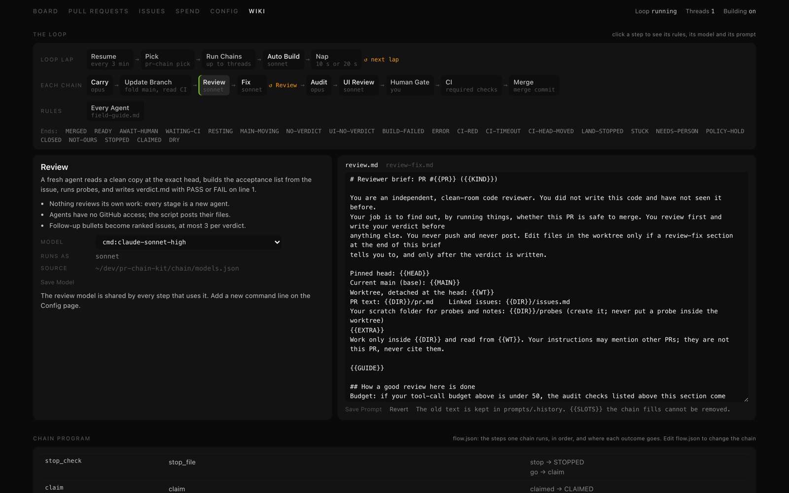

# pr-chain-kit

pr-chain takes the open pull requests on a GitHub repo and walks each one through review, fix,
re-review, audit, UI review, CI and merge. A fresh AI agent (Claude Code or Codex CLI) runs every
stage, so nothing reviews or fixes its own work. Agents have no GitHub access: the script alone
pushes, posts comments and merges.


## How a PR moves

1. **Update branch.** Merge the base branch in if the PR is behind. A red required check sends the failing log lines to a fixer.
2. **Review.** A read-only agent checks out the exact head, runs probes and writes `PASS` or `FAIL` with findings.
3. **Fix.** On `FAIL`, the reviewer fixes its own findings (red test first). A *new* reviewer judges the fix. Capped at 4 rounds.
4. **Audit.** On `PASS`, a stronger model audits the head once more.
5. **UI review** (UI PRs only). A scratch copy of the app starts, a vision model reviews screenshots, and the shots are posted on the PR for a person.
6. **CI and merge.** The script waits for the required checks, approves with a second account and merges through the merge queue.

Every stop has a named end state (`MERGED`, `AWAIT-HUMAN`, `RESTING`, `CI-RED`, ...) and a one-line reason.


## Install

You need Python 3.11+, `git`, the `gh` CLI logged in, and the `claude` or `codex` CLI.

```bash
uvx --from git+https://github.com/maarco/pr-chain-kit pr-chain init   # once published to PyPI: uvx pr-chain init
```

Nothing is copied anywhere else: `uvx` keeps the package in its own cache. To keep a `pr-chain`
command on your PATH, use `uv tool install git+https://github.com/maarco/pr-chain-kit` (later `uv tool install pr-chain`).

`pr-chain init` asks for the repo, its local checkout, your two accounts and the required checks,
writes `~/.config/pr-chain/pr-chain.toml`, and checks that `gh`, `git` and an agent CLI are ready.

| What | Where |
|---|---|
| Your config | `~/.config/pr-chain/pr-chain.toml` (`PR_CHAIN_CONFIG` overrides it) |
| Model choice per stage | `~/.config/pr-chain/models.json`, `commands.json`, `profiles.json` |
| Prompts you edit on the board | `~/.config/pr-chain/prompts/<name>.md`; prompts you never edited keep updating with the kit |
| Limits (PRs at once, rounds...) | `[limits]` in your `pr-chain.toml` |
| Run history, per-PR state, agent logs | `~/.local/state/pr-chain/work` |
| One checkout of your repo per stage | `~/.local/state/pr-chain/wt`, removed when a chain ends |
| The kit's own files | `pr-chain path` prints it |

## Use it

```bash
pr-chain pick                      # read-only: which PR would run next
pr-chain run <pr> --dry-run        # walk one PR without launching agents
pr-chain run <pr> --land           # run it for real
pr-chain board &                   # the board at http://127.0.0.1:8790
nohup pr-chain loop &              # run continuously
```

(With `uvx`, put `uvx pr-chain` where these say `pr-chain`.)

Working from a clone instead: run `python3 -B bin/pr-chain ...` and put your config in
`pr-chain.local.toml` at the repo root. It is gitignored and wins over `~/.config/pr-chain/`. From a clone, board
prompt edits go straight into `chain/prompts/`.

## What your repo needs

- **Two GitHub accounts.** One opens PRs, the other approves and merges (GitHub blocks self-approval).
- **Branch protection with required checks and a merge queue.** `starter-pack/` has the workflows,
  a definition-of-done gate and a one-command branch-protection script. See `starter-pack/README.md`.
- **A field guide** for the agents: your repo map, local check commands and paths they must not
  touch. Start from `examples/kollab/field-guide-project.md` and point `[project] field_guide` at it.

## Settings worth knowing

| Setting | What it does |
|---|---|
| `[repo] run_prefix` | Prefix for the merge-time lint and test commands, e.g. `["uv", "run", "--project", "{wt}", "--"]`. Empty: the configured python. |
| `[paths] models_file` | Which model runs each stage (`commands.json` and `profiles.json` sit beside it). The board edits the same file. `init` points it at `~/.config/pr-chain/`. |
| `[agent] require_sandbox` | Reviewers run under macOS `sandbox-exec` with writes to the checkout denied. On Linux set this to `false`: then a reviewer that changed the worktree has its verdict thrown out. |
| `[ui] enabled` | `false` skips UI review, screenshots and the app stack. |
| `[notify] command` | Pages you when the loop is down, called with one message argument. |
| `[limits]` | Overrides any limit in `chain/flow.json`, e.g. `prs_at_once = 3` (PRs worked on at once) or `max_rounds = 4`. An unknown name is an error. |

Agents run unattended with permission prompts off (`--dangerously-skip-permissions` /
`--dangerously-bypass-approvals-and-sandbox` in `chain/commands.json`). Run the chain on a machine
and accounts you are fine handing to an agent.



## Batch landing

For repos that require "branch up to date" and dismiss approvals on push: landing PRs one by one makes the chain merge
main into every waiting PR each time main moves, which drops its approval and reruns its CI. With `[land] mode = "batch"`
an approved PR's branch is left alone:

1. A chain ends `BATCH-READY`: the status and the approval are posted at the audited head; nothing is merged.
2. `resume` plans the ready PRs on current main (`chain/merge_flow.py`, `git merge-tree` only) and opens one batch PR.
   GitHub marks each PR in it merged when the batch PR merges.
3. Green checks (`SKIPPED` and `NEUTRAL` pass): the batch commit is verified to be exactly the approved heads on main,
   then approved and merged, unless a PR in it has a required check that is not green: then the batch is closed and that
   PR runs its chain. A batch that fails that verification, whose checks do not finish in `ci_wait_max_minutes`, or that
   fails to land twice, is closed too.
4. Main moves or a PR gets a new push: the batch PR is closed and planned again. A pushed PR runs its chain again. A
   batch PR closed by someone else is planned again on the next lap. That close, like the three at the end of step 3,
   is a strike for each waiting PR's head; a second strike at the same head rests the PR instead of planning it again.
5. Red checks: the PRs are split in half and each half gets its own batch; a single red PR goes to a fixer, and rests
   when the same head is red a second time.
6. A PR that clashes with main, or whose base is older than the limit, takes main through the chain. A PR that clashes
   only with another ready PR (or is stacked on another branch) waits; `batch.json` in the work folder lists it as held.

While a PR waits, `<work>/exclude.txt` keeps it out of batches (it stays `BATCH-READY`). A hold or blocking label, a
removed human-approval label, a draft or a withdrawn review ends it `NEEDS-PERSON`. Either one closes an open batch
that holds the PR. A batch PR turned into a draft is left alone until it is ready again.

Known limit: if main moves faster than one batch's CI takes, batches keep restarting and none lands.

| `[land]` key | Default | Meaning |
| --- | --- | --- |
| `mode` | `"pr"` | `"pr"` lands each PR on its own; `"batch"` lands them together |
| `max_base_age_hours` | `48` | a PR whose merge-base with main is older than this takes main once |
| `batch_branch_prefix` | `"merge-flow/batch"` | the batch branch is `<prefix>-<UTC yyyymmdd-HHMMSS>` |

The account that opens the batch PR (your default `gh` login) must differ from its approver
(`[accounts] approver_of`, else `merger`).

Roll back with `mode = "pr"`: `resume` then lands every `BATCH-READY` PR on its own. Close an open batch PR by hand first.

## Layout

```
pr-chain.toml        the commented config template
pr_chain_kit/        the `pr-chain` command (init, board, loop, path; everything else goes to bin/pr-chain)
bin/                 pr-chain, pr-chain-loop, pr-chain-board, worktree-janitor
chain/               flow.json, prompts/, models.json, commands.json, board pages, tests/
agent-kit/           helpers the chain imports: kit.py, land/ (fold, land_pr, changelog_merge)
examples/kollab/     a full working setup for a public Python monorepo
starter-pack/        CI workflows, DoD gate, branch protection, changelog-fragment rule
vendor/three/        three.js r186 (MIT) for the board's loop drawing
docs/                OPERATOR.md (running it), design.md (why it is built this way), PROOF.md
```

## Tests

```bash
for t in chain/tests/test_*.py; do python3 -B "$t"; done
```

Scratch git repos and stubs only: no `gh`, no agents, no network. Checks that need a real kollab
checkout skip themselves unless `KOLLAB_CHECKOUT` points at one.

## Contributing

Issues and pull requests are welcome: see `CONTRIBUTING.md` for setup, the rules for a PR and how releases
work. Changes per version are in `CHANGELOG.md`.

## License

MIT, see `LICENSE`. `vendor/three/` is three.js, also MIT.
