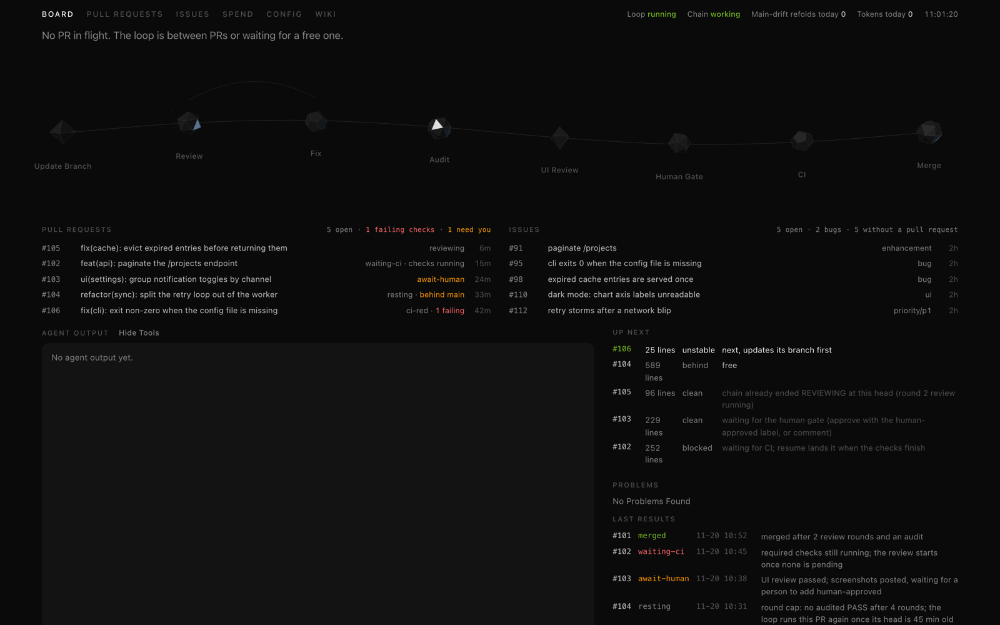
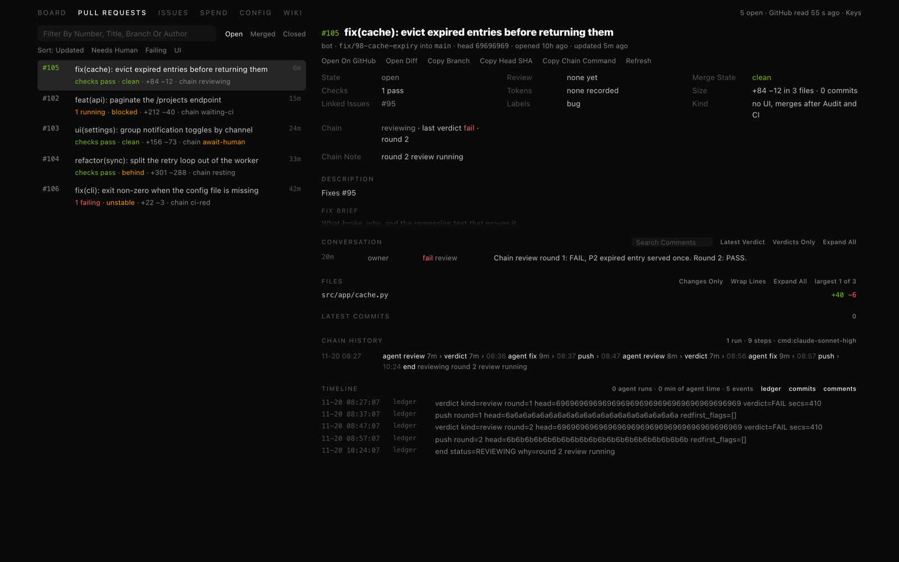

# pr-chain-kit

pr-chain takes the open pull requests on a GitHub repo and walks each one through review, fix,
re-review, audit, UI review, CI and merge. A fresh AI agent (Claude Code or Codex CLI) runs every
stage, so nothing reviews or fixes its own work. Agents have no GitHub access: the script alone
pushes, posts comments and merges.



## How a PR moves

1. **Update branch.** Merge the base branch in if the PR is behind. A red required check sends the failing log lines to a fixer.
2. **Review.** A read-only agent checks out the exact head, runs probes and writes `PASS` or `FAIL` with findings.
3. **Fix.** On `FAIL`, the reviewer fixes its own findings (red test first). A *new* reviewer judges the fix. Capped at 4 rounds.
4. **Audit.** On `PASS`, a stronger model audits the head once more.
5. **UI review** (UI PRs only). A scratch copy of the app starts, a vision model reviews screenshots, and the shots are posted on the PR for a person.
6. **CI and merge.** The script waits for the required checks, approves with a second account and merges through the merge queue.

Every stop has a named end state (`MERGED`, `AWAIT-HUMAN`, `RESTING`, `CI-RED`, ...) and a one-line reason.



## Quickstart

You need: Python 3.11+, `git`, the `gh` CLI logged in, and the `claude` or `codex` CLI.

```bash
git clone <this repo> && cd pr-chain-kit
cp examples/kollab/pr-chain.toml pr-chain.local.toml   # gitignored; loaded automatically
$EDITOR pr-chain.local.toml                            # repo, accounts, paths, checks
python3 -B bin/pr-chain pick                           # read-only: which PR would run next
python3 -B bin/pr-chain run <pr> --dry-run             # walk one PR without launching agents
python3 -B bin/pr-chain run <pr> --land                # run it for real
python3 -B bin/pr-chain-board 8790 &                   # the board at http://127.0.0.1:8790
nohup python3 -B bin/pr-chain-loop &                   # run continuously
```

`pr-chain.toml` is the commented template with every setting. Put your real values in
`pr-chain.local.toml`: it is gitignored and wins over `pr-chain.toml`. `PR_CHAIN_CONFIG=<file>` wins
over both.

## What your repo needs

- **Two GitHub accounts.** One opens PRs, the other approves and merges (GitHub blocks self-approval).
- **Branch protection with required checks and a merge queue.** `starter-pack/` has the workflows,
  a definition-of-done gate and a one-command branch-protection script. See `starter-pack/README.md`.
- **A field guide** for the agents: your repo map, local check commands and paths they must not
  touch. Start from `examples/kollab/field-guide-project.md` and point `[project] field_guide` at it.

## Settings worth knowing

| Setting | What it does |
|---|---|
| `[repo] run_prefix` | Prefix for the merge-time lint and test commands, e.g. `["uv", "run", "--project", "{wt}", "--"]`. Empty: the configured python. |
| `[paths] models_file` | Which model runs each stage (`commands.json` and `profiles.json` sit beside it). The board edits the same file. |
| `[agent] require_sandbox` | Reviewers run under macOS `sandbox-exec` with writes to the checkout denied. On Linux set this to `false`: then a reviewer that changed the worktree has its verdict thrown out. |
| `[ui] enabled` | `false` skips UI review, screenshots and the app stack. |
| `[notify] command` | Pages you when the loop is down, called with one message argument. |
| `chain/flow.json` | Every stage, limit and end state. `limits.prs_at_once` caps how many PRs run at once. |

Agents run unattended with permission prompts off (`--dangerously-skip-permissions` /
`--dangerously-bypass-approvals-and-sandbox` in `chain/commands.json`). Run the chain on a machine
and accounts you are fine handing to an agent.


## Layout

```
pr-chain.toml        the commented config template
bin/                 pr-chain, pr-chain-loop, pr-chain-board, worktree-janitor
chain/               flow.json, prompts/, models.json, commands.json, board pages, tests/
agent-kit/           helpers the chain imports: kit.py, land/ (fold, land_pr, changelog_merge)
examples/kollab/     a full working setup for a public Python monorepo
starter-pack/        CI workflows, DoD gate, branch protection, changelog-fragment rule
vendor/three/        three.js r186 (MIT) for the board's loop drawing
docs/                OPERATOR.md (running it), design.md (why it is built this way), PROOF.md
```

## Tests

```bash
for t in chain/tests/test_*.py; do python3 -B "$t"; done
```

Scratch git repos and stubs only: no `gh`, no agents, no network. Checks that need a real kollab
checkout skip themselves unless `KOLLAB_CHECKOUT` points at one.

## License

MIT, see `LICENSE`. `vendor/three/` is three.js, also MIT.
